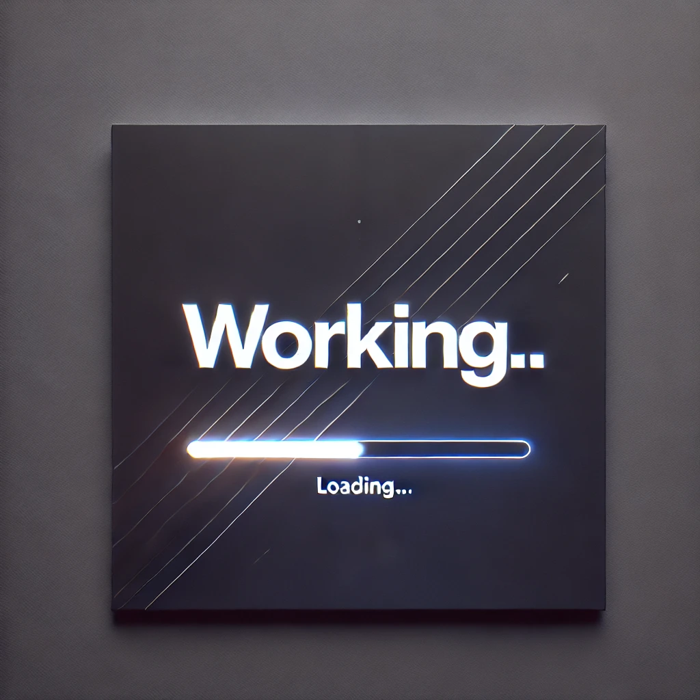

# 👨🏻‍💻 Currently Developing

<div align="center">
<!-- <a href="https://porfolio.dev/"> -->

<!-- </a> -->
<p></p>
</div>

<div align="center">


</div>
<p></p>

## Cómo agregar un proyecto

1. Copiá `src/content/projects/_template.md` como `src/content/projects/<slug>.md` y completá los campos (título, resumen y descripción en español e inglés). El `slug` define la URL: `/proyectos/<slug>`.
2. Generá la media del sitio deployado (necesita Google Chrome instalado):

   ```bash
   node scripts/capture.mjs <slug> <url>        # cover.webp, mobile.webp, mobile-full.webp
   node scripts/record-scroll.mjs <slug> <url>  # scroll.webm, scroll.mp4, poster.webp (10 s)
   ```

   Todo queda en `public/projects/<slug>/`. Para proyectos sin URL pública, poné capturas o un video propio en esa carpeta.
3. Referenciá los archivos en `media` (el `video` va sin extensión) y sacá `draft: true`.

Las tecnologías del campo `stack` son claves de `src/data/tags.js`.
