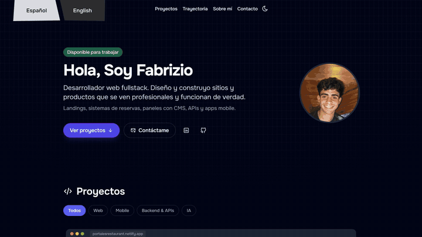

<div align="center">

# Portfolio.dev

Portfolio bilingüe (ES/EN) para desarrolladores, hecho con Astro + Tailwind.
Con scripts que **generan solos las capturas y el video de cada proyecto**.


**[🔗 Ver demo en vivo](https://fabriziodev-portfolio.netlify.app/)**

[](https://app.netlify.com/start/deploy?repository=https://github.com/Fabrizio9898/Portfolio.dev)



</div>

## ✨ Qué trae

- **Español / inglés** con selector de idioma y sin recargar la página.
- **Modo claro / oscuro**.
- **Proyectos como archivos Markdown**, con filtros por categoría y una página de detalle para cada uno (`/proyectos/<slug>`).
- **Capturas y videos automáticos**: le pasás la URL de tu proyecto y genera la portada, las capturas mobile y un video de scroll.
- **Video promo para redes**: graba tu propio portfolio en formato horizontal (X/Facebook) y vertical (Reels/TikTok).
- Animaciones con scroll, transiciones entre páginas y footer tipo "telón".

## 🚀 Usalo como tu portfolio

```bash
# 1. Click en "Use this template" (arriba a la derecha) o cloná el repo
git clone https://github.com/Fabrizio9898/Portfolio.dev.git mi-portfolio
cd mi-portfolio
pnpm install
pnpm dev
```

### 2. Poné tus datos

| Qué | Dónde |
| --- | --- |
| Nombre, email, redes, foto, descripción SEO | `src/config.ts` |
| Foto de perfil | `public/` (y apuntala en `config.ts`) |
| Textos de la UI: saludo, pitch, contacto | `src/i18n/es.json` y `src/i18n/en.json` |
| Experiencia laboral | `src/components/Experience/Experience.astro` |
| Educación | `src/components/Experience/Education.astro` |
| Sobre mí | `src/components/About/AboutMe.astro` |
| Proyectos | `src/content/projects/*.md` (ver abajo) |

Borrá los proyectos de ejemplo de `src/content/projects/` y `public/projects/` y cargá los tuyos.

### 3. Deploy

Viene configurado para **Netlify** (`@astrojs/netlify`). Conectá el repo y listo. Para Vercel, cambiá el adapter en `astro.config.mjs`.

## 📁 Cómo agregar un proyecto

1. Copiá `src/content/projects/_template.md` como `src/content/projects/<slug>.md` y completá los campos (título, resumen y descripción en español e inglés). El `slug` define la URL: `/proyectos/<slug>`.
2. Generá la media del sitio deployado (necesitás Google Chrome y [ffmpeg](https://ffmpeg.org/) instalados):

   ```bash
   node scripts/capture.mjs <slug> <url>        # cover.webp, mobile.webp, mobile-full.webp
   node scripts/record-scroll.mjs <slug> <url>  # scroll.webm, scroll.mp4, poster.webp (10 s)
   ```

   Todo queda en `public/projects/<slug>/`. Para proyectos sin URL pública, poné tus capturas o un video propio en esa carpeta.
3. Referenciá los archivos en `media` (el `video` va sin extensión) y sacá `draft: true`.

Las tecnologías del campo `stack` son claves de `src/data/tags.js`.

## 🎬 Video promo para redes

```bash
pnpm dev   # o usá la URL de tu sitio deployado
node scripts/record-promo.mjs http://localhost:4321/ promo dark
```

Genera `promo/promo-horizontal.mp4` (1920×1080) y `promo/promo-vertical.mp4` (1080×1920).

## 🤝 Créditos

Licencia [MIT](./LICENSE): usalo, modificalo y publicalo como quieras.
Si te sirvió, **dejá el link "Template" del footer** y una ⭐ al repo. Y si lo publicás, etiquetame: me encanta ver qué arman.

Hecho por [Fabrizio Andrade](https://www.linkedin.com/in/fabrizio-andrade/).
